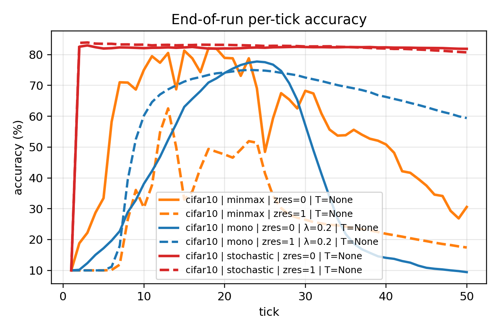
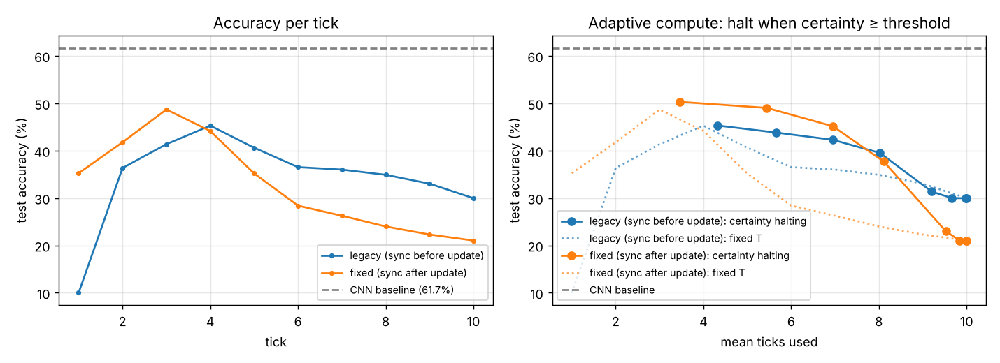

# CTM-CIFAR (Multi-tick refinement for CIFAR-10/100)

Implementation of a CTM-style multi-tick refinement classifier for CIFAR-10 / CIFAR-100 with:

- Multi-tick logits (T_train ticks for training, T_eval_mult * T_train ticks for eval)
- Multiple objective options:
  - minmax: 0.5 * (min CE over ticks + CE at max-certainty tick)
  - monotone: CE(final) + λ · mean ReLU(CE(t+1) − CE(t) + margin)
  - allticks: mean CE over all ticks + λ · monotone penalty
  - stochastic: sample a stop tick N and train only that tick
- Deterministic, stable run folders with per-run JSON logs + global runs.csv
- Per-tick tracking and summary plotting scripts

This repo is meant to be an implementation of Sakana AI's continuous thought machines with the addition of a residual connection and optional normalization in the neuron synchronization step, while also adding different loss functions.

Also included:

- A held-out **validation split** (5,000 training images) for picking the epoch and the evaluation tick, and a single final evaluation on the **test set**
- Four **evaluation rules**: `final`, `certainty`, `best_tick` (chosen on validation) and `mean_logits`
- An **adaptive-compute curve**: halt each image once its certainty passes a threshold; accuracy vs mean ticks used
- A **CNN baseline** with the same backbone, to measure what the recurrent ticks add
- Checkpoints (`best.pt`, `last.pt`), `scripts/evaluate_checkpoint.py`, `scripts/plot_compare.py`
- Optional `torch.compile` and `channels_last`, tests and CI

### Version 0.2: a tick-0 fix

Up to 0.1 the output synchronisation (and with it the logits of tick *t*) was computed from the neuron state *before* tick *t* updated it. As a result, the tick-0 logits were the same for every image (chance accuracy), and every later tick lagged one step behind its own attention read. In the CTM paper, the logits are read from the updated state. That is now the default (`--sync_after_update 1`). `--sync_after_update 0` is bit-identical to the old model (a test checks this against the original code), so older runs can be reproduced. The results figure below was produced with the old ordering and with validation on the test set.

## Project structure

    ctm-cifar/
      src/ctm_cifar/
        __init__.py
        config.py
        data.py
        model.py
        losses.py
        metrics.py
        logging_utils.py
        train.py
        eval.py
        plotting.py
      scripts/
        train_ctm_cifar.py
        evaluate_checkpoint.py
        plot_summary.py
        plot_compare.py
      tests/
      results/
      README.md
      pyproject.toml
      LICENSE
      .gitignore

## Installation

Option A: editable install (recommended)

    python -m venv .venv
    source .venv/bin/activate
    pip install -U pip
    pip install -e ".[dev]"     # pytest + ruff; run the tests with `pytest`

Option B: minimal deps (no packaging)

    pip install torch torchvision matplotlib tqdm numpy

## Quickstart

Single run (CIFAR-10)

    python scripts/train_ctm_cifar.py \
        --device cuda \
        --dataset cifar10 \
        --epochs 50 \
        --batch_size 256 \
        --loss_type minmax \
        --eval_rule certainty \
        --z_residual 1 \
        --amp

Outputs a run folder under:

    runs/<run_name>_<dataset>_loss=..._<config hash>/

with:

- config.json, model_stats.json
- history.json (per epoch: per-tick validation metrics and every eval rule)
- eval_per_tick.json, tick_tracking.pt
- best.pt (best epoch by validation under `--eval_rule`), last.pt
- final_metrics.json: the best checkpoint on the test set, with every eval rule, per-tick accuracy and the adaptive-halting curve

Plus a global runs.csv in runs/.

Evaluate a checkpoint later, optionally with more ticks:

    python scripts/evaluate_checkpoint.py runs/<run>/best.pt --T_eval 50

Compare runs:

    python scripts/plot_compare.py runs/<a> runs/<b> --labels a b --out compare.png

CNN baseline with the same backbone:

    python scripts/train_ctm_cifar.py --model_type cnn --eval_rule final --epochs 50

## Canonical sweeps

4-run sweep: minmax/monotone × zres off/on

    python scripts/train_ctm_cifar.py \
        --device cuda \
        --dataset cifar10 \
        --epochs 50 \
        --batch_size 256 \
        --sweep4 \
        --lambda_mono 0.2 \
        --amp

Lambda sweep for monotone (within sweep4: minmax plus one monotone run per lambda, for each z_residual)

    python scripts/train_ctm_cifar.py \
        --device cuda \
        --dataset cifar10 \
        --epochs 30 \
        --batch_size 256 \
        --sweep4 \
        --lambda_sweep 0,0.01,0.02,0.05,0.1,0.2,0.3 \
        --amp

## Plotting sweep summaries

After runs exist:

    python scripts/plot_summary.py --out_root ./runs

This writes to:

    runs/summary_plots/

Main figures:

- val_acc_vs_epoch.png
- val_ce_vs_epoch.png
- val_acc_besttick_vs_epoch.png
- val_acc_certtick_vs_epoch.png
- eval_per_tick_acc.png
- eval_per_tick_ce.png
- eval_per_tick_certainty.png
- cv_figure.png

Filter by dataset:

    python scripts/plot_summary.py --out_root ./runs --dataset cifar10

## Key flags (training)

Every field of `TrainConfig` is a flag with the same name. Boolean flags take 0/1 and can be given bare (`--amp` means `--amp 1`). `--seeds 0,1,2` repeats every run over seeds.

Common:

- --dataset {cifar10,cifar100}
- --device {cpu,cuda}
- --amp (bfloat16 autocast + GradScaler on CUDA)
- --epochs, --batch_size, --grad_accum
- --lr, --weight_decay, --warmup_steps
- --loss_type {minmax,monotone,allticks,stochastic}
- --eval_rule {final,certainty,best_tick,mean_logits} (also the epoch-selection criterion)
- --T_train, --T_eval_mult
- --val_size (default 5000; 0 = validate on the test set, as in 0.1)
- --model_type {ctm,cnn}
- --sync_after_update {0,1} (0 = 0.1 behaviour)
- --compile, --channels_last
- --halt_thresholds 0.5,0.7,0.9

Model size:

- --D : action/state dim
- --M : FIFO history length
- --H : per-neuron MLP hidden size
- --attn_dim, --attn_heads
- --Dout_pairs, --Dact_pairs
- --syn_depth, --syn_bottleneck
- --dropout

Ablations / compute:

- --z_residual {0,1} : residual update z ← z + η·dz vs overwrite
- --additive_logits : logits(t) = sum_{k<=t} delta_logits(k) (cumulative refinement)
- --state_feat {0,1} : fixed tokens vs state-dependent features per tick
- --hyper_rank, --hyper_hidden : hypernetwork settings (when --state_feat 1)
- --stoch_truncate_compute : in stochastic mode, only run N ticks to save compute
- --track_every : per-tick tracking cadence

Monotone loss:

- --lambda_mono
- --mono_margin
- --lambda_sweep "0,0.05,0.1,0.2"

## Reproducibility

- The run folder always contains a full config.json.
- The run ID is a stable hash of the config (excluding run_tag).
- Seeds set both torch and numpy (and DataLoader generator).

## Results

End-of-run **per-tick validation accuracy** on CIFAR-10 for three training objectives (**minmax**, **monotone**, **stochastic**), each with and without the *z-residual* connection (`zres=0` solid, `zres=1` dashed).
Training was done just for T=25 ticks, but evaluation was conducted up to 50 ticks.

Key takeaways from this run:
- **Stochastic** training reaches the best and most stable performance across ticks (≈ low-80% and flat).
- **Monotone** improves up to a mid-tick peak but degrades at later ticks (collapse for `zres=0`, slower decay for `zres=1`).
- **Minmax** peaks around mid ticks but is noticeably less stable, and the residual variant underperforms here.

### Check of the tick-0 fix (small CPU runs)

To check the fix, I ran three short CIFAR-10 runs on 2 CPU cores: the old ordering, the fixed ordering and the CNN baseline. Each run used 6 epochs of 150 steps, batch size 128, lr 1e-3, a small CTM (D=128, M=8, H=32, syn_depth=2, 279k parameters), T_train=5 and evaluation at 10 ticks. All numbers are on the test set, using the epoch selected on validation. The script is `results/cpu_tick0_check/run.sh` and the metrics are in the same folder.

| model | tick 1 | best fixed tick | certainty rule | final tick (10) | halting @ 0.5 |
|---|---|---|---|---|---|
| legacy order | 10.0% (chance) | 45.3% (tick 4) | 55.0% | 30.0% | 45.3% @ 4.3 ticks |
| fixed order | 35.2% | 48.7% (tick 3) | 52.8% | 21.0% | 50.3% @ 3.5 ticks |
| CNN baseline (150k params) | 61.7% | – | – | – | – |

Reading this honestly:

- **The fix works.** Tick 1 goes from chance (identical logits for every image) to 35%. Every fixed tick count up to 3 is better, and certainty-based halting reaches its best accuracy with fewer ticks.
- **The certainty rule is roughly a tie.** On one seed, the gap between 52.8% and 55.0% is within run-to-run noise.
- **Both models fall apart beyond T_train.** Ticks 6–10 lose 20–30 points, so evaluating at 2×T does not extrapolate at this scale.
- **On this short budget the CNN baseline wins.** It is better with fewer parameters and twice the throughput. These are tiny, short runs, though; at full size and with stochastic training, the results above reach around 80%. The baseline is now easy to run next to any configuration, and that is the comparison this benchmark should report.

## Citation / attribution

If you publish results using this code, cite the original CTM work.
Original paper: [arXiv:2505.05522](https://arxiv.org/abs/2505.05522)
